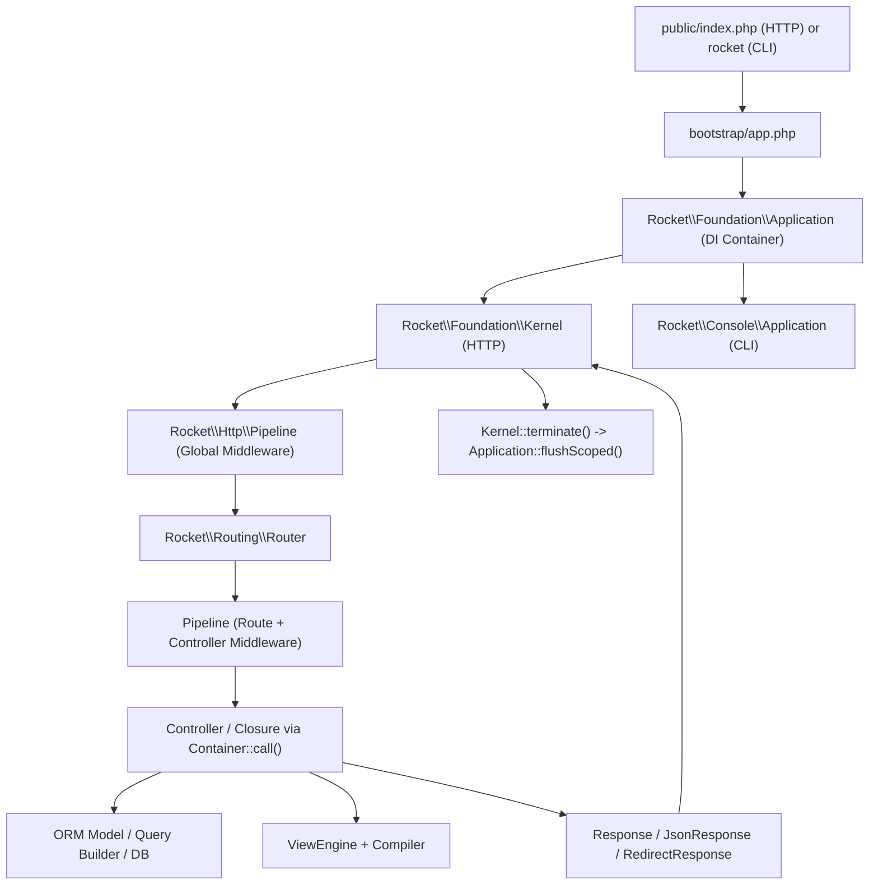
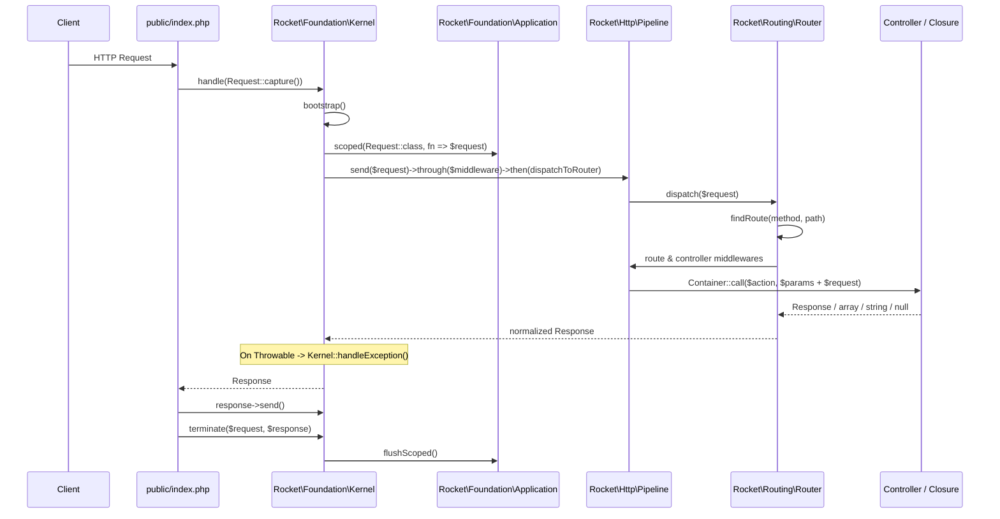

# RocketPHP Internal Architecture

This document explains how RocketPHP is structured internally, how it boots, how HTTP and CLI lifecycles execute, and how components interact.

---

## 1. Architectural Overview (MVC + Service Container)

RocketPHP implements a lightweight MVC architecture powered by a central **Service Container** (`Rocket\Foundation\Application` extending `Rocket\Container\Container`):

- **Model**: `Rocket\Database\ORM\Model`, `ModelBuilder`, `Query\Builder`, `Connection`, `DatabaseManager`
- **View**: `Rocket\View\ViewEngine`, `Compiler`, `Component`, `ComponentAttributeBag`, `ComponentSlot`, `Vite`
- **Controller**: `Rocket\Routing\Controller`, `Router`, `Route`, `Pipeline`, `Request`, `Response`
- **Extensibility**: `Rocket\Foundation\ServiceProvider`, `Config`, `Env`, `Facade`

---

## 2. Application Initialization & Bootstrapping

Bootstrapping happens in two distinct phases:

### Phase 1: [`bootstrap/app.php`](../bootstrap/app.php)
1. Instantiates `new Application(dirname(__DIR__))`:
   - `Application::setBasePath()` binds container path instances: `'path.base'`, `'path.app'`, `'path.config'`, `'path.public'`, `'path.storage'`, `'path.resources'`, `'path.database'`.
   - `Application::registerBaseBindings()` sets `Container::setInstance($this)` and registers `'app'`, `Container::class`, `Application::class`.
2. Immediately registers 5 service providers via `$app->register(...)` (invoking each provider's `register()` method immediately):
   1. `Rocket\Routing\RouteServiceProvider` -> binds `'router'`, `Router::class`, `RouterContract::class`
   2. `Rocket\View\ViewServiceProvider` -> binds `'view.compiler'`, `CompilerInterface::class`, `'view'`, `ViewEngineInterface::class`, `ViewEngine::class`
   3. `Rocket\Database\DatabaseServiceProvider` -> binds `'db'`, `DatabaseManager::class`, `'db.connection'`, `ConnectionContract::class`, `Connection::class`
   4. `Rocket\Security\SecurityServiceProvider` -> binds `'security.hasher'`, `'security.encrypter'`, `'session'`, `'security.csrf'`, `'security.limiter'` (plus interfaces/class aliases)
   5. `App\Providers\AppServiceProvider` -> user application bindings
3. Registers `'kernel'` (`Rocket\Foundation\Kernel`) and `'vite'` (`Rocket\Foundation\Vite`) singletons.

> **Important:** `Rocket\Cache\CacheServiceProvider` is **not** registered in `bootstrap/app.php` or `config/app.php` by default.

### Phase 2: `Kernel::bootstrap()` vs `Console\Application`

- **HTTP (`Kernel::bootstrap()`)**:
  1. Guards with `$this->bootstrapped` boolean.
  2. Loads `.env` via `Env::load($this->app->basePath('.env'))`.
  3. Instantiates `Config` and calls `loadFromDirectory($this->app->configPath())` (requires every `config/*.php` file), then binds `'config'` and `Config::class`.
  4. Loops over `config('app.providers', [])` and calls `$this->app->register($provider)`. Already-registered providers are skipped via `$this->loadedProviders[$providerClass]`.
  5. Calls `$this->app->boot()`:
     - Calls `bootstrapConfig()` (no-op if `'config'` already bound).
     - Calls `$provider->boot()` on every registered provider in registration order (which causes `RouteServiceProvider::boot()` to load `routes/web.php` and `routes/api.php`, and `AppServiceProvider::boot()` to execute).
     - Marks `$this->booted = true`.
- **CLI (`Console\Application::run()`)**:
  1. Calls `$this->app->boot()` (Note: `Application::boot()` calls `bootstrapConfig()` + `boot()` on providers already registered in `bootstrap/app.php`; unlike `Kernel::bootstrap()`, it does **not** re-read `config('app.providers')` to register extra providers added only to `config/app.php`).
  2. Calls `$this->discover()` to load `app/Console/Commands/*.php` and `routes/console.php`.

---

## 3. HTTP Request Lifecycle

### Key Execution Details
1. **Method Spoofing**: `Request::capture()` inspects `$_POST['_method']` or `HTTP_X_HTTP_METHOD_OVERRIDE` when `$_SERVER['REQUEST_METHOD'] === 'POST'`.
2. **Global Middleware**: `Kernel::$middleware` runs before routing. Empty by default.
3. **Route Resolution (`Router::findRoute`)**:
   - Checks O(1) static map `$this->staticRoutes[$method][$path]` first.
   - Falls back to iterating `$this->dynamicRoutes[$method]`.
   - If unmatched, scans all routes with `matchesPath($path)`: throws `MethodNotAllowedException` (405) if path exists under another method, otherwise `RouteNotFoundException` (404).
4. **Controller Middleware**: If `$action` is `[Class, method]` and `Class` extends `Rocket\Routing\Controller`, `Router` resolves the controller via `$this->container->make($class)` and extracts method-filtered middleware (`only` / `except`).
5. **Action Invocation**: `Container::call($action, $parameters)` resolves method parameters from route params, `Request`, and DI bindings.
6. **Response Normalization**: `Router::toResponse()` converts `Response` (as-is), `array`/`JsonSerializable` (`JsonResponse`), `null` (`204`), or scalar/stringable (`Response` 200).
7. **Termination**: `Response::send()` outputs headers, cookies, body, and calls `fastcgi_finish_request()` if available; then `Kernel::terminate()` calls `$app->terminate()` -> `Container::flushScoped()`.

---

## 4. Dependency Injection & Container Lifetimes

`Rocket\Container\Container` supports four binding types:

| Method | Behavior | Worker / Long-Running Lifecycle |
| :--- | :--- | :--- |
| `bind($abstract, $concrete, false)` | New instance on every `make()` | Transient |
| `singleton($abstract, $concrete)` | Created once, stored in `$instances` | Persists across `flushScoped()` |
| `scoped($abstract, $concrete)` | Created once per cycle in `$scopedInstances` | Cleared by `flushScoped()` on `terminate()` |
| `instance($abstract, $objectOrValue)` | Pre-built value/object stored in `$instances` | Persists across `flushScoped()` |

Reflection metadata for constructors and methods is cached statically on the class in `Container::$constructorCache` and `Container::$methodCache`.

---

## 5. Component Relationships & Extension Points

| Subsystem | Core Classes | Primary Extension Points |
| :--- | :--- | :--- |
| **Bootstrapping** | `Application`, `Kernel`, `ServiceProvider` | Add `ServiceProvider` subclasses in `app/Providers/` and register in `bootstrap/app.php` & `config/app.php` |
| **Routing & HTTP** | `Router`, `Route`, `Pipeline`, `MiddlewareInterface` | Register routes in `routes/web.php`/`api.php`; attach `MiddlewareInterface` classes on routes, controllers, or `Kernel` |
| **Database** | `DatabaseManager`, `Connection`, `Query\Builder`, `Model` | Configure drivers in `config/database.php`; extend `Model` (`SoftDeletes`, `hasOne`, `hasMany`, `belongsTo`) |
| **Views** | `ViewEngine`, `Compiler`, `Component`, `Vite` | Custom directives (`Compiler::directive()`), anonymous/class `<x-...>` components, view namespaces (`View::addPath($path, $ns)`) |
| **Security** | `Hasher`, `Encrypter`, `CsrfTokenManager`, `Validator`, `RateLimiter` | Attach `VerifyCsrfToken`, `SecureHeaders`, `ThrottleRequests` middlewares; use `Hasher`/`Encrypter`/`Validator` |
| **Cache** | `CacheManager`, `ArrayStore`, `FileStore` | Register `CacheServiceProvider`; implement `CacheStoreInterface` |
| **Console** | `Console\Application`, `Command`, `ClosureCommand` | Add `Command` classes to `app/Console/Commands/` or closure commands in `routes/console.php` |

> **Worker Mode Caveat:** While `Application::terminate()` flushes `$scopedInstances`, note that `RateLimiter::$storage`, `Router::$routes`, `Env::$repository`, and `SessionManager` hold in-memory state. In RoadRunner/Swoole/FrankenPHP workers, avoid mutating singletons or `Router` per-request, and recognize `RateLimiter` shares static state across requests in the worker process.
